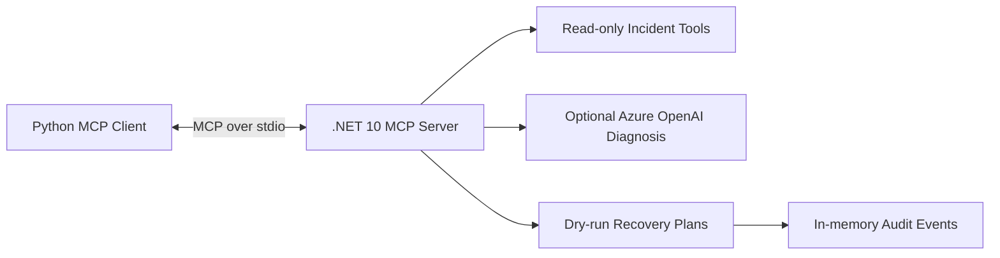

# Enterprise AI MCP Server

**.NET 10 · C# · Python 3.12 · Model Context Protocol · Azure OpenAI (optional)**

A hands-on reference implementation of an MCP-based incident investigation platform. The server exposes typed tools for incident lookup, service-health inspection, advisory AI diagnosis, and **simulation-only** recovery planning. A Python client consumes the tools over stdio.

> **Portfolio demo, not a production incident-response system.** All incident data is synthetic. No real remediation is possible.

## Architecture



## Capabilities

| Capability | Implementation | Boundary |
| --- | --- | --- |
| Incident lookup and service health | Typed C# MCP tools | Synthetic data |
| AI diagnosis | Azure OpenAI chat completions | Optional credentials, advisory only |
| Recovery planning | Allowlisted simulation previews | No execution endpoint |
| Audit inspection | In-memory event records | Not durable |
| Testing | xUnit, pytest, MCP stdio E2E | CI |
| Evaluation | Deterministic MCP fixtures + JSON report | Not AI quality scoring |

## Quick start

Requires the **.NET 10 SDK** and **Python 3.12+**. From the repository root:

```bash
dotnet restore tests/IncidentMcpServer.Tests/IncidentMcpServer.Tests.csproj
dotnet build src/IncidentMcpServer/IncidentMcpServer.csproj
python -m venv .venv
# macOS/Linux: source .venv/bin/activate
# Windows PowerShell: .venv\\Scripts\\Activate.ps1
python -m pip install -r python-client/requirements.txt
python python-client/client.py
```

## Tests and evaluation

```bash
dotnet test tests/IncidentMcpServer.Tests/IncidentMcpServer.Tests.csproj
python -m pytest python-client/tests -q
python evals/run_evals.py --output evals/results.json
```

The evaluation suite checks known/unknown incident handling and recovery safety responses. **It does not measure AI diagnosis accuracy.**

## Documentation

- [Demo walkthrough](docs/demo.md)
- [Architecture](docs/architecture.md)
- [Azure OpenAI configuration](docs/azure-openai.md)
- [Recovery safety model](docs/recovery-workflows.md)
- [Evaluation methodology](docs/evaluation.md)

## Security and limitations

No secrets or proprietary telemetry belong in this repository. The AI integration is read-only and disabled without environment configuration. MCP recovery tools only create and inspect synthetic plans; approval and real execution are not exposed. In-memory audit and plan data are for demonstration, not compliance or production use.

## Roadmap

- Add mocked AI diagnosis tests and an opt-in, human-labeled model evaluation suite
- Add authenticated Azure Monitor adapter and managed identity
- Introduce durable audit storage and a separate, authenticated approval control plane
- Add observability dashboards, deployment templates and threat modeling
