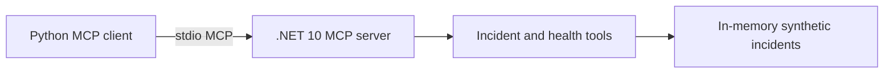

# Architecture (v1)

This initial version intentionally contains **no live Azure connection**, no AI diagnosis, and no recovery executor. It is a read-only foundation for later Azure OpenAI and policy-gated recovery features.

## Security boundaries
- Data is synthetic and stored in source for demonstration.
- Tools do not mutate resources.
- The stdio transport runs as a local subprocess; do not expose it as an unauthenticated network service.
- Future production integrations will require scoped credentials, authorization, audit logs and human approval for recovery actions.
