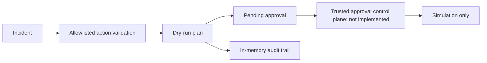

# Recovery workflow — simulation-only v1

This milestone deliberately **does not implement real remediation**. The MCP surface exposes only preview, plan inspection, and audit inspection.

## Flow

## Supported demo actions
- `restart-worker-simulation`
- `requeue-message-simulation`

All other actions are rejected. Resolved or unknown incidents are rejected.

## Security model
- MCP callers cannot approve or execute plans.
- No Azure credentials, production adapters, shell commands, or resource mutation.
- Plans and audit events are in-memory only; they disappear on restart.
- The internal approval/simulation method is intentionally not exposed as an MCP tool.
- A future real implementation must authenticate the approver independently, bind approval to immutable plan contents, use expiration and idempotency, persist tamper-evident audit logs, enforce per-resource authorization, and support rollback.
- AI output must never be treated as authorization.

## Follow-up
Add an authenticated approval service, durable audit storage, integration tests, and narrowly scoped adapters in separate reviewed PRs. Do not enable real actions without a production security review.
